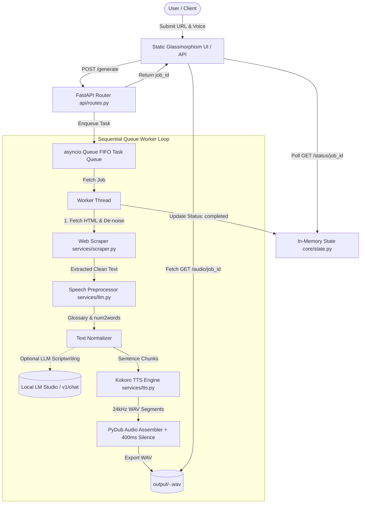

# 🔊 WebToSpeech AI — Local Article Voice Studio

> **Transform any web article into natural, studio-quality speech locally on your machine.**  
> 100% private, zero cloud API fees, and fully accelerated for modern hardware.

[](https://www.python.org/)
[](https://fastapi.tiangolo.com/)
[](https://huggingface.co/hexgrad/Kokoro-82M)
[](https://www.docker.com/)

---

## 📖 Table of Contents

- [Overview](#-overview)
- [Key Features](#-key-features)
- [System Architecture](#-system-architecture)
- [Project Structure](#-project-structure)
- [Prerequisites](#-prerequisites)
- [Installation & Setup](#-installation--setup)
  - [Method 1: Local Native Setup (Recommended)](#method-1-local-native-setup-recommended)
  - [Method 2: Docker Container Setup](#method-2-docker-container-setup)
  - [Method 3: Optional Local LLM (LM Studio)](#method-3-optional-local-llm-lm-studio)
- [REST API Reference](#-rest-api-reference)
  - [Endpoints Summary](#endpoints-summary)
  - [Request & Response Examples](#request--response-examples)
- [Pronunciation Glossary & Customization](#-pronunciation-glossary--customization)
- [Limitations](#-limitations)
- [Future Scope](#-future-scope)
- [Acknowledgements & Tech Stack](#-acknowledgements--tech-stack)

---

## 🌟 Overview

**WebToSpeech AI** is an end-to-end, locally hosted web reader pipeline that automatically scrapes articles, strips away web clutter (cookie banners, sidebars, navigation bars, author metadata, dialogs, and ads), intelligently normalizes technical jargon and numbers for speech, and synthesizes clear, high-fidelity 24kHz audio using the ultra-lightweight and expressive **Kokoro TTS** neural engine.

The platform provides both a **RESTful FastAPI backend** with an asynchronous task queue and a **sleek glassmorphic web dashboard** featuring live progress indicators, elapsed timers, in-browser playback, WAV downloads, and an editable pronunciation glossary.

---

## ⚡ Key Features

- **🛡️ 100% Local & Privacy-First**: All scraping, text preprocessing, and audio synthesis run directly on your own hardware. No external audio APIs, no usage fees, and no data tracking.
- **🧹 Heuristic Article De-noising**: Built with BeautifulSoup to eliminate noisy web elements:
  - Decomposes non-content structural tags (`<nav>`, `<header>`, `<footer>`, `<aside>`, `<form>`, `<svg>`, `<noscript>`).
  - Strips accessibility overlays and ARIA dialogs (`dialog`, `alertdialog`, `banner`, `search`).
  - Cleans modal overlays, cookie disclaimers, teaser grids, and chatbot widgets.
  - Automatically locates the primary article container (`<article>`, `<main>`, `id="content"`) and preserves header-to-paragraph reading flow.
- **🎙️ Kokoro-82M Neural Synthesis**:
  - Delivers expressive, natural intonation at **24,000 Hz WAV**.
  - Built-in multi-voice support: `female` (`af_heart`) and `male` (`am_michael`).
  - Tuned cadence with an optimized **1.2x speech rate**.
  - Dynamic **400ms inter-sentence silence insertion** via PyDub to create natural breathing pauses between thoughts.
  - Micro-chunk suppression and unicode normalization to prevent acoustic hallucinations.
- **🧠 Dynamic Pronunciation & Text Normalization**:
  - Numeric expansion to natural spoken words via `num2words` (e.g., `42` → *"forty-two"*).
  - Common technical unit expansions (e.g., `2 GHz` → *"two gigahertz"*, `AI` → *"artificial intelligence"*, `e.g.` → *"for example"*).
  - Configurable phonetic dictionary (`core/glossary.json`) that can be edited live directly through the UI.
  - Optional zero-temperature LLM scriptwriting mode (compatible with local **LM Studio** / OpenAI-compatible local endpoints) for contextual expansions without paraphrasing.
- **🚦 Asynchronous Sequential Task Queue**:
  - Implements an `asyncio.Queue` background worker loop to process synthesis tasks sequentially (1-at-a-time).
  - Protects host memory (VRAM / RAM) from allocation spikes and out-of-memory crashes during heavy synthesis.
  - Non-blocking job submission (`/generate`) with status polling (`queued` → `processing` → `completed`).
- **🎨 Modern Glassmorphic Web Dashboard**:
  - High-end dark theme with smooth gradients and micro-interactions.
  - Real-time synthesis progress bar and stopwatch timer.
  - Embedded HTML5 audio player and one-click direct WAV download.
  - Integrated in-browser JSON editor for real-time glossary tuning.

---

## 🏗️ System Architecture

The pipeline seamlessly coordinates four specialized services:



### Hardware Context & Memory Efficiency
- **Apple Silicon (macOS)**: Running the application natively in a Python virtual environment allows Kokoro and PyTorch to access unified system memory and Metal/MPS acceleration directly, avoiding Docker VM memory virtualization overhead.
- **Linux / CUDA**: Can run natively or via Docker with NVIDIA GPU pass-through for accelerated inference.

---

## 📁 Project Structure

```plaintext
Text_to_Speech/
├── api/
│   ├── models.py           # Pydantic request & response schemas
│   └── routes.py           # FastAPI router endpoints & background worker loop
├── core/
│   ├── glossary.json       # Customizable acronym/pronunciation dictionary
│   ├── logging.py          # Centralized logging format & file output config
│   └── state.py            # Global in-memory job state & lazy asyncio task queue
├── output/                 # Generated WAV files and temporary synthesis chunks
├── services/
│   ├── llm.py              # Text normalization & optional LM Studio integration
│   ├── scraper.py          # BeautifulSoup article extractor & noise filter
│   └── tts.py              # Kokoro TTS engine, chunk synthesis & PyDub assembly
├── static/
│   └── index.html          # Responsive glassmorphism web UI & glossary manager
├── .gitignore              # Git ignore rules for environments, outputs, and cache
├── Dockerfile              # Containerization definition with ffmpeg & libsndfile
├── main.py                 # Application entry point, CORS config, and startup hook
├── architecture.md         # High-level architecture summary
├── requirements.txt        # Pinned Python package dependencies
└── README.md               # Project documentation
```

---

## 💻 Prerequisites

Ensure your system meets the following prerequisites before running the project:

| Component | Requirement | Notes |
|---|---|---|
| **Python** | `3.10` or `3.11` | Python 3.11 recommended |
| **FFmpeg** | Required | Needed by `pydub` for audio chunk assembly and silence padding |
| **libsndfile** | Required | Needed by `soundfile` for reading/writing 24kHz audio buffers |
| **RAM** | 8 GB minimum (16 GB recommended) | Unified memory on Apple Silicon provides peak performance |
| **Disk Space** | ~2 GB free | For PyTorch wheels, Kokoro model weights, and output audio |

### Installing System Dependencies

**macOS (Homebrew):**
```bash
brew install ffmpeg libsndfile
```

**Ubuntu / Debian:**
```bash
sudo apt update
sudo apt install -y ffmpeg libsndfile1
```

---

## 🚀 Installation & Setup

### Method 1: Local Native Setup (Recommended)

1. **Clone the repository and navigate into the folder:**
   ```bash
   git clone https://github.com/akash250899/webpage-to-speech-local-ai.git
   cd webpage-to-speech-local-ai
   ```

2. **Create and activate a virtual environment:**
   ```bash
   python3 -m venv ai_voice_env
   source ai_voice_env/bin/activate
   # On Windows (cmd): ai_voice_env\Scripts\activate.bat
   # On Windows (PowerShell): ai_voice_env\Scripts\Activate.ps1
   ```

3. **Install dependencies:**
   ```bash
   pip install --upgrade pip
   pip install -r requirements.txt
   ```

4. **Launch the server:**
   ```bash
   python main.py
   ```

5. **Open the web dashboard:**  
   Navigate to [http://localhost:8000](http://localhost:8000) in your web browser.

---

### Method 2: Docker Container Setup

You can also run the application inside a lightweight container:

1. **Build the Docker image:**
   ```bash
   docker build -t web-to-speech-ai .
   ```

2. **Run the container:**
   ```bash
   docker run -d \
     --name web-to-speech-app \
     -p 8000:8000 \
     -v $(pwd)/output:/app/output \
     web-to-speech-ai
   ```

3. **Access the application:**  
   Visit [http://localhost:8000](http://localhost:8000).

---

### Method 3: Optional Local LLM (LM Studio)

If you wish to enable the optional LLM-assisted text expansion mode:

1. Download and open [LM Studio](https://lmstudio.ai/).
2. Load any instruction-following model (e.g., *Meta-Llama-3-8B-Instruct*, *Mistral-7B-Instruct*, or *Qwen-2.5*).
3. Start the **Local Server** inside LM Studio on port `1234` (`http://localhost:1234`).
4. In your API request or code, set `"use_llm": true`. If LM Studio is not running, the pipeline automatically falls back to deterministic rule-based processing without crashing.

---

## 📡 REST API Reference

The service exposes a clean set of REST endpoints for programmatic automation and headless integrations.

### Endpoints Summary

| Method | Endpoint | Description |
|---|---|---|
| `GET` | `/api/health` | Health check and runtime environment info |
| `GET` | `/scrape` | Extract cleaned text from a target web URL |
| `POST` | `/process-speech` | Preprocess and normalize text for speech |
| `GET` | `/glossary` | Retrieve current technical pronunciation dictionary |
| `POST` | `/glossary` | Update technical pronunciation dictionary JSON |
| `POST` | `/generate` | Enqueue a full scraping-to-speech synthesis pipeline task |
| `GET` | `/status/{job_id}` | Check job status, progress metadata, or errors |
| `GET` | `/audio/{job_id}` | Stream or download the generated 24kHz `.wav` file |

---

### Request & Response Examples

#### 1. Queue an Audio Generation Job
```bash
curl -X POST "http://localhost:8000/generate" \
     -H "Content-Type: application/json" \
     -d '{
       "url": "https://www.synopsys.com/blogs/chip-design/ai-compute-architecture-evolution.html",
       "voice": "female",
       "max_chunks": null,
       "use_llm": false
     }'
```
**Response:**
```json
{
  "job_id": "84d72023-e5e1-45f8-b325-1e34e402867c",
  "status": "queued",
  "voice": "female",
  "message": "Pipeline execution queued"
}
```

#### 2. Check Job Status
```bash
curl -X GET "http://localhost:8000/status/84d72023-e5e1-45f8-b325-1e34e402867c"
```
**Response (In-Progress):**
```json
{
  "job_id": "84d72023-e5e1-45f8-b325-1e34e402867c",
  "status": "processing",
  "url": "https://www.synopsys.com/blogs/chip-design/ai-compute-architecture-evolution.html",
  "voice": "female",
  "created_at": "2026-10-16T14:30:10.123456",
  "started_at": "2026-10-16T14:30:11.234567"
}
```
**Response (Completed):**
```json
{
  "job_id": "84d72023-e5e1-45f8-b325-1e34e402867c",
  "status": "completed",
  "file_path": "output/ai-compute-architecture-evolution-female.wav",
  "paragraph_count": 18,
  "character_count": 6420,
  "voice": "female",
  "completed_at": "2026-10-16T14:30:42.789012"
}
```

#### 3. Download Generated Audio
```bash
curl -O -J "http://localhost:8000/audio/84d72023-e5e1-45f8-b325-1e34e402867c"
```

#### 4. Scrape Raw Content Only
```bash
curl -X GET "http://localhost:8000/scrape?url=https://example.com/article"
```
**Response:**
```json
{
  "url": "https://example.com/article",
  "character_count": 2150,
  "content": "Article title\n\nFirst paragraph content..."
}
```

#### 5. Read / Update Pronunciation Glossary
```bash
# Retrieve current glossary
curl -X GET "http://localhost:8000/glossary"

# Update glossary entries
curl -X POST "http://localhost:8000/glossary" \
     -H "Content-Type: application/json" \
     -d '{
       "EDA": "Electronic Design Automation",
       "CPU": "Central Processing Unit",
       "SaaS": "sass",
       "GUI": "gooey",
       "IEEE": "I triple E",
       "LLM": "large language model"
     }'
```

---

## 📖 Pronunciation Glossary & Customization

Text-to-speech engines frequently struggle with domain-specific abbreviations, acronyms, and phonetic quirks. WebToSpeech AI includes a dynamic glossary system stored in `core/glossary.json`.

### Default Glossary Format
```json
{
  "EDA": "Electronic Design Automation",
  "CPU": "Central Processing Unit",
  "SaaS": "sass",
  "GUI": "gooey",
  "IEEE": "I triple E",
  "API": "A P I",
  "I/O": "input output",
  "GPUs": "G P U s",
  "CXL": "C X L"
}
```

- **Boundary-aware replacement**: Replacements match whole words (`\bWORD\b`) to prevent accidental sub-string corruption.
- **Live UI update**: Change pronunciations on the fly via the web dashboard without restarting the server.

### Voice Customization
Voices can be mapped or extended in [services/tts.py](file:///Users/akashverma/AI/Text_to_Speech/services/tts.py):
```python
VOICE_MAPPING = {
    "female": "af_heart",
    "male": "am_michael",
    # Add other Kokoro voices: e.g. "af_bella", "am_adam"
}
```

### Pacing & Pauses
Sentence chunk boundaries are combined with a customizable dynamic silence duration (default: **400ms**) in `services/tts.py`:
```python
dynamic_silence = AudioSegment.silent(duration=400, frame_rate=tts_chunk.frame_rate)
```

---

## ⚠️ Limitations

- **Client-Rendered SPAs**: Scrapes static HTML via BeautifulSoup; dynamic client-side JS apps (React/Vue SPAs) or heavy paywalls/CAPTCHAs may require pre-rendered HTML.
- **In-Memory State**: Job tracking and queue entries reside in process memory and reset upon server restart (saved WAV files persist in `output/`).
- **Sequential Queue**: Processes synthesis tasks one at a time via FIFO queue to prevent GPU/RAM memory spikes.
- **Uncompressed WAV Output**: Produces studio-quality 24kHz WAV; output is not pre-compressed to MP3/Opus.
- **English-Focused Synthesis**: Model pipeline is currently configured for American English (`lang_code='a'`).
- **External LLM Requirement**: Optional LLM mode requires a local OpenAI-compatible endpoint (e.g., LM Studio on port 1234).

---

## 🗺️ Future Scope

- **CMS & Publishing Integrations**: Out-of-the-box webhooks and plugins for WordPress, Ghost, Strapi, Webflow, and AEM to automatically trigger narration synthesis and embed audio players on article publish.
- **Headless Browser Scraping**: Playwright/Crawl4AI support for JavaScript-heavy and paywalled sites.
- **Audio Compression & Real-Time Streaming**: Native MP3/Opus encoding and real-time chunk streaming (SSE/WebSockets).
- **Multilingual Support**: Language auto-detection and multi-voice routing (Spanish, French, Japanese, etc.).
- **Persistent Queue & DB**: SQLite/PostgreSQL job persistence and Redis/Celery background task execution.
- **Synchronized Transcripts**: Word/sentence timestamp generation (`.vtt`) with on-page karaoke-style reading.
- **Voice Cloning**: Custom reference voice cloning and speaker timbre blending.
- **Browser Extension**: One-click "Listen to Article" extension for Chrome, Safari, and Firefox.
- **Podcast RSS Feeds**: Automatic RSS feed generation to sync narrated articles directly to podcast apps.

---

## 🛠️ Acknowledgements & Tech Stack

- **[Kokoro-82M](https://huggingface.co/hexgrad/Kokoro-82M)** by hexgrad — Ultra-efficient open-weight text-to-speech model.
- **[FastAPI](https://fastapi.tiangolo.com/)** — Modern, high-performance async Python web framework.
- **[BeautifulSoup4](https://www.crummy.com/software/BeautifulSoup/)** — Resilient HTML parsing and DOM traversal.
- **[PyDub](http://pydub.com/)** & **[soundfile](https://pysoundfile.readthedocs.io/)** — Professional audio manipulation and silence assembly.
- **[num2words](https://github.com/savoirfairelinux/num2words)** — Multilingual number-to-words converter.
